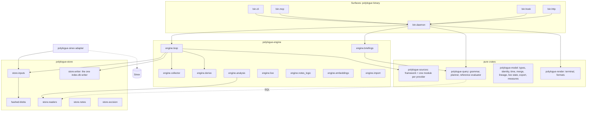

# The outline: the whole finished Polylogue, breadth-first

The spec says what Polylogue does; the slices say in what order it is built.
The outline sits between them: every component of the finished system, each
with one responsibility, the data it owns, what it uses and the slice that
makes it real, so we can see that the parts fit together before any of them
is built. It is the second of the progressively more solid stages (vision,
spec, **outline**, skeleton, slices; the operator asked for "breadth-first,
top-down" stages, "ghostly outlines of things... multiple stages of
progressively more solid", "so we see if things fit together well").

- `components.toml`: 63 components (the field list is at its top).
- `check_outline.py` (flake check `polylogue-outline`): nothing in the
  spec, the vision, the laws, the slices or the schema is left without a
  component, and no component breaks the workspace's rules. What it checks
  is listed in its docstring; each check was confirmed to fail on a
  deliberately broken outline.

Solidity: **outline** (named and placed, nothing more), **specified** (the
spec defines it), **prototyped** (code exists and runs, path given),
**built**. The `solidity` fields in `components.toml` give the current status; the outline checker lists them. Compiling signatures are not built components.

## The system in one page

**Data flow.** Provider files, spools, imports and Drive reach
`engine.collector`, which classifies each change; `store.inputs` keeps every
revision's bytes in `hashed-blobs`; the provider's module in
`polylogue-sources` parses through the per-record framework; `store.writer`,
the only writer of `index.db`, writes each session in one transaction, with
its search rows, live tables and git links; `engine.derive` finishes what
the writer could not. Reads go `bin.daemon` → `polylogue-query` (compiled to
SQL) → `store.readers` → `polylogue-render`. Notes, kept results, variants and
excisions live in `archive.db` (`store.notes`, `store.excision`);
`embeddings.db` holds only paid vectors (`store.embeddings`).

**Crate edges** (`plan/workspace.md`): model ← sources, query, render;
model, hashed-blobs ← store; model, sources, query, store ← engine; the
binary uses everything; the optional `polylogue-sinex` uses model and store.
The check refuses any `uses` across crates that this list does not allow.

**Who owns what.** Each of the 48 tables in the three DDLs has exactly one
owner. Tables are written by their owner, or by a component the owner lists
as a writer; `index.db` is written only by `store.writer` (law 61), so live
tables, git links, page maps and search rows all name it.

## The ghostly parts

Components only at outline solidity, where the spec names a capability but
the design is thinnest:

| Component | Slice | What is missing |
|---|---|---|
| `engine.model_read` | 11 | How a model is chosen, budgeted and cited when it reads selected sessions; how its answers become notes with provenance. The vision's `agent-behaviour` and `idea-ledger` uses lean on it. |
| `engine.schema` | 8 | The offline schema command and generator are named; their output format and how drift reaches `status` are not designed. |
| `engine.workbench` | 12 | Pages, workspaces, investigations and pings: a minimal model exists in `user-data.md`, no request shapes or storage. |
| `bin.http` | 10 | `spec/surfaces/web.md` exists; the request-to-route mapping and the token handshake are prose only. |

Joint gaps from the vision, which no component provides and which belong to
the joint outline (`polylogue-sinex-joint/`): identity of a person or thing
across sources (8 uses), surfacing something unasked (4 uses), speech as a
source (1 use).

## What outlining found, and what was done

- **Briefings before notes.** Slice 2 briefings have sections built from
  notes (open items, decisions, lessons), but notes arrive in slice 7. Until
  then such a section would have read as "none", which says no decisions
  were made. Fixed in `spec/user-data.md` (fitting the budget, rule 5): a
  section whose data the build does not have yet renders "not available",
  like a failed read.
- **The Python client had no slice.** Lynchpin reads Polylogue through it
  (`plan/migration.md`), yet no slice built it. Placed in slice 4, with the
  old archive's data (`plan/slices.md`).
- **Takeovers need reference resolution.** Slice 2's takeover briefings
  resolve exact session IDs; provider links resolve from slice 6. Recorded
  as a `later` use rather than a change.
- **The full grammar is a slice-1 component.** `plan/slice-01.md` parses the
  whole grammar from the start (only field support grows), so
  `query.grammar` is slice 1, not 3.
- **Three laws were at the wrong component.** Law 14 (usage arithmetic) is
  slice 1, so token arithmetic (`model.measures`) is too; law 79 (ambiguous
  ID prefixes) and law 82 (both full-text plans give the same top k) belong
  to the query planner, not to link resolution and embeddings. Law 79 also
  had a slice-4 part (ChatGPT sandbox links) its index row omitted; the row
  and its `Slice:` line now say both (`plan/testing/laws.md`).
- **The blob store is store's, so its types stay inside store** (found
  writing the skeleton). `store.inputs` took `hashed_blobs::Store` and its
  hash in its signatures, which the engine cannot name: workspace.md gives
  the engine no edge to `hashed-blobs`. `store.inputs` now exposes `Blobs`,
  the archive's blob store handle, and takes hashes as the model's
  `BlobHash`; no edge was added.

## Questions the outline raised

1. **The prototype's crate split differs from the workspace's.** The
   prototype has `daemon` and `client` crates; the workspace puts the daemon
   in the binary and its logic in `engine`, and live-state rules in `model`.
   When slice 1 starts, the prototype's daemon crate should be split along
   the outline (`live.rs` rules into `model.live_state`, `brief.rs` into
   `engine.briefings`, `notes.rs` into `store.notes` and
   `engine.notes_logic`). Proposed, not done.
2. **Excision and the one writer.** `store.excision` writes `archive.db` and
   `embeddings.db` directly but changes `index.db` only through the loop and
   `store.writer` (rebuilding affected sessions, `archive-db.md`, how
   excision works). That keeps law 61; the outline records it as a `uses`
   of the writer.
3. **`model.lineage` is only specified.** Lineage rules exist inside the
   prototype's Claude Code parser and model, but not as the separate rule
   set the spec describes; the slice-1 lineage laws (11, 29–34, 39, 99)
   have no prototype of their own yet.
4. **The daemon and loop grow by slice.** Their `later` lists are long by
   design (each parser and verb arrives with its slice); the skeleton should
   make that growth visible as one module per arriving part.
