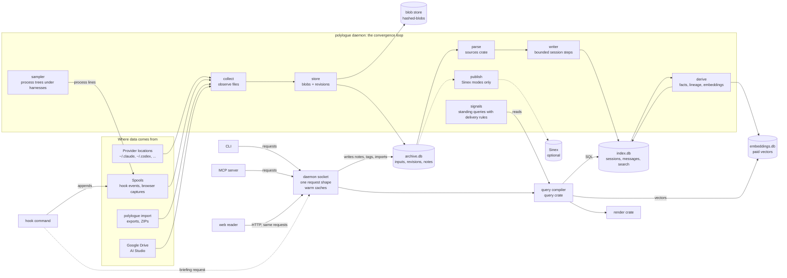

# Architecture

How the parts fit, on one page, then one Claude Code session followed from
a file append to a search result and a briefing. Each box names the file
that owns its rules.

## The whole system

- **Collect, store** (`spec/convergence.md`, `spec/storage/README.md`): the loop
  watches the canonical provider locations and Polylogue's own spools,
  classifies each change (unchanged, appended, head rewritten, rewritten,
  replaced, touched, renamed, deleted, back), records an observation in `archive.db`, and keeps every
  revision's bytes in the blob store as extents over immutable blobs.
- **Parse** (`spec/sources/README.md`): one parser per provider format, a pure
  function of the input's bytes, its companion files and the carried state
  from the previous append.
- **Write** (`spec/convergence.md`): one writer thread merges each session's
  records into `index.db`, field by field in a fixed order, so the result
  does not depend on arrival order.
- **Derive** (`spec/convergence.md`, `spec/analysis.md`): products the
  writer could not finish (after a version or price change, a late parent,
  embeddings).
- **Read** (`spec/query.md`, `spec/surfaces/README.md`, `spec/rendering.md`): every
  surface goes through one query compiler that produces SQL over `index.db`,
  and one rendering crate. Every client (CLI, MCP servers, the briefing hook, the browser host) sends
  requests to the daemon over one local socket, and the web reader is served
  by the daemon itself over loopback HTTP with the same request shape; the
  daemon answers from warm state and is the only writer of all three
  databases (`decisions/process.md`).
- **Live state and signals** (`spec/model.md`, live state; `spec/user-data.md`,
  signals): a sampler records the process trees under agent harnesses as
  lines in a spool, collected like any input; each session's state
  (working, waiting on you, idle, ended, stale) is computed at read time
  from stored facts and the clock. Signals are watches with a delivery rule,
  re-read when data arrives or a `for` deadline falls due; every delivery is
  recorded.
- **Briefings** (`spec/surfaces/mcp-and-hooks.md`, `spec/user-data.md`): the
  hook asks the daemon, which assembles references and short lines within
  the harness's size limit, credential-shaped text masked (joint decision
  31), and records what it gave and left out.
- **Sinex** (`decisions/sinex.md`): off by default; in its modes the publish
  step sends Sinex what it does not yet hold, through an adapter crate behind
  the Cargo feature `sinex`, which the default build does not include. In
  `primary`, store places new bytes into Sinex's content store instead of
  the local blob store, which then holds only a pending area of unconfirmed
  inputs (joint decision 27).

The three databases split by one rule (`decisions/storage-files.md`):
`archive.db` holds what cannot be recomputed, `index.db` what can, and
`embeddings.db` what costs money to recompute.

Crates (`plan/workspace.md`): `polylogue-model` (types and identity rules),
`polylogue-sources` (parsers), `polylogue-query`, `polylogue-render` (all
pure: no files, clock or environment), `polylogue-store` and `hashed-blobs`
(storage), `polylogue-engine` (the loop), the `polylogue` binary, and the
optional `polylogue-sinex`.

## One session, end to end

A Claude Code session in `~/.claude/projects/-home-op-morrow/` gains four
records: the operator's prompt, the model's reply written as two records (a
text block and a `tool_use` block, sharing `message.id` and `requestId`),
and the tool result.

1. **Hook.** Claude Code runs `polylogue hook` on the prompt. It writes one
   line to a new spool file of its own (opened exclusively, named after the
   hook process), syncs it, and exits within a few milliseconds; it never
   touches a database (`spec/sources/README.md`, hooks;
   `spec/surfaces/mcp-and-hooks.md`).
2. **Collect.** A file notification wakes the loop. Collect compares the
   session file with the latest `observation` for that path in `archive.db`
   (`file_cursor` in `index.db` is only a cache of it): same device and
   inode, larger size, the sampled windows before the old end unchanged, so
   the class is *appended* (`spec/storage/blobs.md`, observing a file).
3. **Store.** The new bytes, cut at the last complete line, become one
   blob, stored as a piece on the input's current chain: the blob row is
   written as `writing`, then the file, then the row turns `present` with
   the extent that places it. Within the minute (at most one per minute per
   file), a `revision` row and an `observation` row cover every piece
   stored since the last one (`spec/storage/blobs.md`). After a crash, the
   next round finishes whatever is half done.
4. **Parse.** The Claude Code parser reads only the new bytes, starting
   from the stored read position and carried state (open tool calls, the
   map from record to message). The two reply records form one message
   (`decisions/one-message-per-response.md`). The tool result pairs with its
   call; its outcome comes from the result's error flag and denial kind
   (`is_error`, `toolDenialKind`), and its exit code is kept beside it
   (`sources/claude-code.md`, tool calls).
5. **Write.** In one transaction the writer adds the messages, blocks and
   texts, the `tool_call` row, the search rows for new text, and updates the
   session's order and facts by adding the new records' contribution
   (`spec/convergence.md`). The write counter advances, so the change feed
   and `polylogue status` see the change.
6. **Derive.** Nothing to do unless a version changed or embeddings are
   configured; then the new text gets a vector keyed by its BLAKE3 hash and
   the embedding key.
7. **Search.** `polylogue chrono` is a request over the daemon's socket; the
   daemon compiles it (or reuses a cached plan) to SQL over the full-text index
   for prose, folds letters the same way the index did, groups hits by
   session and renders the result (`spec/query.md`, `spec/rendering.md`).
8. **Briefing.** The next session the operator starts in this directory runs
   the SessionStart hook, which asks the daemon over its socket for a
   directory briefing (no daemon: no briefing, and the hook still exits 0):
   recent work here and the session's own open ending, each with its
   reference, within the harness's size limit (`spec/user-data.md`);
   decisions and open questions come from notes, so until notes exist
   (slice 7) those sections say "not available", never "none". Credential-shaped
   text is masked, and in backed mode a machine section from Sinex is added
   under its own deadline (joint decisions 18 and 31). The hook appends a
   `delivery` line to the spool, recording what it gave and what it left
   out; that line becomes a `delivery` row like any other input.
